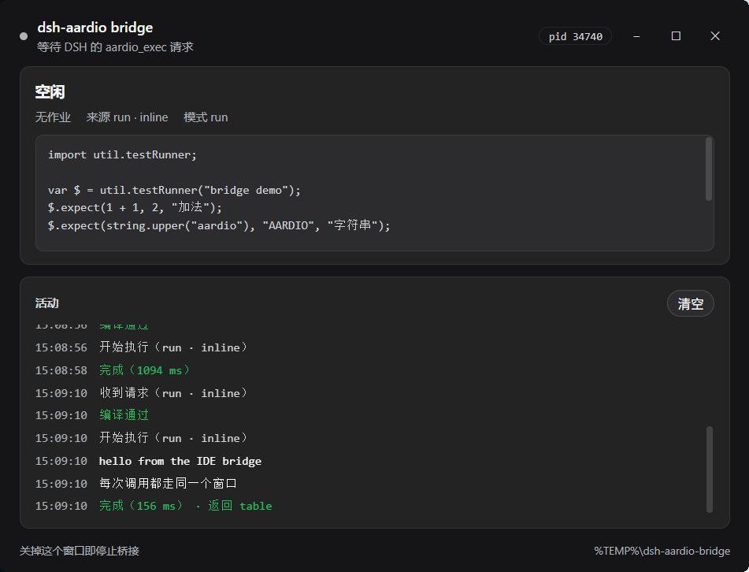

# dsh-aardio

[](https://github.com/MFn233/dsh-aardio/actions/workflows/test.yml)

[DeepSeek Harness](https://github.com/deepseek-ai/deepseek-harness) 的 aardio 工具链插件：内置三个 aardio 编写技能、一个面向模型的文档搜索引擎、两条常驻的工程协作规则；可就地把文件或工程交给 aardio IDE 打开，并在插件页里选好 aardio 安装目录 —— 不再把路径写死在代码里。

[English](README.md) | 中文 · [GitHub](https://github.com/MFn233/dsh-aardio)

## 界面



<sub>`aardio_exec` 执行时，桥接窗口会显示它在做什么：请求来源与模式、当前代码、逐行 `print`、编译失败，以及每次结果的耗时。</sub>

## 包含什么

| 类型 | 名称 | 作用 |
|---|---|---|
| 技能 | `aardio` | 语法铁律、本机文档地图、写代码的工作流 |
| 技能 | `aardio-project` | `*.aproj` 工程结构、版本属性、发布设置与踩坑 |
| 技能 | `aardio-library` | 用户库/扩展库：`intellisense`/`details` 注释块与文档目录规范 |
| 工具 | `aardio_docs` | 安装目录的搜索引擎：多关键词、引号短语、排除词、排序 + 上下文，并能直接读安装目录里的任意文件 |
| 工具 | `aardio_exec` | 通过可选的桥接，在你开着的 IDE 里编译或运行 aardio 代码，回传 `print` 输出、`return` 值与报错 |
| 工具 | `aardio_open` | 用 aardio IDE 打开 `.aardio` 文件、`.aproj` 或工程目录 |
| 工具 | `aardio_env` | 报告插件解析到的安装目录、来源，以及探测过的位置 |
| 设置 | 配置页 | 选择包含 `aardio.exe` 的文件夹，可浏览选择，也可一键恢复自动探测 |
| 规则 | `dsh-aardio:project-rules` | 常驻系统提示：工程由用户建、`dlg/`/`lib/` 改动要请用户在 IDE 里刷新 |

## 安装

**从插件页安装（推荐）**：打开 **插件 → 添加插件**，选择本插件所在目录并安装。安装后插件会被激活；如果插件页之前就开着，刷新一下页面。

**命令行安装：**

```powershell
dsh plugin --profile desktop add dsh-aardio
# 或者安装本地检出目录：
dsh plugin --profile desktop add link:D:\path\to\dsh-aardio
```

卸载：`dsh plugin --profile desktop remove dsh-aardio`。

安装后，新会话的技能目录里会出现三个 aardio 技能，工具列表里会出现三个工具。

## 指定 aardio 安装目录

**不需要改 YAML**。插件按这个顺序确定安装目录：

1. 设置项 `aardioRoot`（见下一节）；
2. 环境变量 `AARDIO_ROOT` 或 `AARDIO_HOME`；
3. 自动探测：`%ProgramFiles%\aardio`、`%LOCALAPPDATA%\aardio`、`%APPDATA%\aardio`，以及每个固定磁盘上的 `aardio`、`Develop\aardio`、`Program Files\aardio`、`Applications\aardio`、`software\aardio`、`tools\aardio`。

目录里有 `aardio.exe` 才算有效安装。全都找不到时，工具会在报错里列出探测过的每个目录，`aardio_env` 也能随时查看同样的信息。

### 设置页在哪

表单就在插件自己的页面上：**插件 → aardio 工具链**。它渲染在插件说明下面、组件列表上面，打开插件就能看到；`dsh-aardio` 那一行标题旁的小箭头打开的「行页面」里是同一个表单。

- **aardio 所在文件夹**：可以手输，也可以点 **选择文件夹…** 用系统文件夹选择窗口挑。粘贴进来的各种写法会先被规范化：带引号的路径、`file:///` 链接、正斜杠、结尾反斜杠，甚至直接粘 `aardio.exe` 的完整路径。
- **保存**：写进 profile 的配置层并立即生效 —— 这个字段声明为 volatile，插件不会重启，工具下一次调用就用新目录。
- **改回自动查找**：清掉存下来的值（只有真的存过值时才出现），回到自动探测。

留空就是自动查找；清空时写入的是「未设置」而不是空字符串，所以不会盖住 patch 层里的值。

手工管理 profile 时，也可以直接在 `cordis.patch.yml` 里固定：

```yaml
- id: dsh-aardio
  name: dsh-aardio
  config:
    aardioRoot: D:/path/to/aardio
```

写在 patch 里属于组合层默认值：设置页会显示为「继承」，仍可覆盖或清除。

## 工具细节

### `aardio_docs`：搜索 + 直读

这个搜索引擎是给模型用的，不是给人看结果页的：

| 输入 | 含义 |
|---|---|
| `query` | `listview checked` 要求文件里两个词都有；`"引号短语"` 要求相邻；`-词` 排除 |
| `scope` | `docs`、`examples`、`lib`、`all`（默认） |
| `mode` | `all`（默认）或 `any`；多词查询无结果时自动放宽为 `any`，并在 `relaxed` 里标明 |
| `context` | 每个命中附带几行上下文，0–4，默认 1 |
| `limit` / `perFile` | 总命中数（默认 12，最多 40）与单个文件保留数（默认 2） |
| `path` | 不搜索，直接读文件：绝对路径或相对安装目录的路径 |

排序偏向真正能回答「这个 API 怎么用」的证据：词命中了文件名、出现在行首（定义行）、是文档页（`.md`）、或位于 `index.md`。`string.save` 的独立用法会压过 `string.saveFiles` 这类前缀；多词查询只有在该文件里这些词出现在 20 行以内才算命中；疑似二进制的文件跳过；相邻命中若上下文重叠只保留最好的一条。

`path` 可以读安装目录里的任意文本文件（每次 400 行，支持 `offset`/`lines`），即使别的工具的沙箱进不了那个目录；安装目录之外的路径会被拒绝。

搜索预算：最多 12000 个文件、256 MB、单文件 2 MB，触到会标记 `truncated`；文件清单缓存 30 秒，所以同一轮里重复查询很便宜。

### `aardio_open` 与 `aardio_env`

`aardio_open`：`path`；传目录时优先打开其中的 `default.aproj`，让 IDE 恢复整个工程而不是单个文件。启动后立即返回，不阻塞会话。

`aardio_env`：无参数。检索不到东西时先调它 —— 它会告诉你解析到的目录、来源（设置 / 环境变量 / 自动探测）、`aardio.exe` 是否存在，以及探测过哪些目录。

## 常驻的工程协作规则

除了技能，插件还会往系统提示里加一条短规则（`dsh-aardio:project-rules`，order 10500，纯文本不插值）：

1. **工程归用户。** 模型不得新建工程、也不得手写 `default.aproj`；工程由用户在 aardio IDE 里创建，模型只改 `main.aardio`、资源和代码。
2. **改过 `dlg/` 或 `lib/` 要请用户刷新。** 之后必须提醒用户重开工程或重启 IDE，否则 IDE 会沿用缓存的窗体与库。
3. **验证优先无头测试。** 用 aardio 自带的 `util.testRunner` 写 `*.test.aardio`，请用户 F5 后把 JSON 贴回；不要首选截图识别或模拟输入，GUI 冒烟不要进入 `win.loopMessage()`。

规则只写在一处，方便日后整体替换或删除；部署里没有 `ctx.systemPrompt` 时这条规则不注册，插件其余功能照常。

## 无头验证

aardio 自带 `util.testRunner` —— 一个专为 Agent 设计的 Jest/PyTest 风格结构化断言引擎，aardio 自己的 Agent（AA / autos）就是用它来验证的，而不是靠截图。本插件沿用同一套流程：

- [skills/aardio/references/headless-tests.md](skills/aardio/references/headless-tests.md) 里有模板、完整 API（`test`、`expect`、`expectNear`、`contains`、`match`、`throws`、`notThrows`、`assert`、`fail`、`log`、`report`），以及纯逻辑、文件读写、`gdip` 离屏像素、GUI 冒烟四种场景的写法。
- 模型在你工作区写 `xxx.test.aardio`，你在 IDE 里按 F5，把 `print(JSON.stringify($.report()))` 打出的 JSON 贴回来。
- 失败记录带 `file` 和 `line`，下一轮就是修，而不是猜。

插件**不能自己跑这份测试**，除非下面的桥接开着：aardio 没有无头命令行入口，`loadcode`/`loadcodex` 只在 aardio 进程内可用。

## IDE 桥接（`aardio_exec`）

桥接只要启动一次，验证就从「请用户按 F5」变成一次工具调用。

1. 在 aardio IDE 里打开 `bridge/aardioBridge.aardio`（也可以让我用 `aardio_open` 打开），按 **F5**。
2. 留着那个窗口。它会实时显示桥接在干什么——状态、当前作业与代码、逐行到达的 `print`、编译失败、结果——没有请求时保持空闲；关掉窗口就停止。
3. 之后模型可以直接调用：
   - `aardio_exec({ code, mode: "check" })`：只编译，报错带行号；
   - `aardio_exec({ code })` 或 `aardio_exec({ path })`：执行并回传 `print(...)` 的全部输出、`return` 值（JSON）、`compileError` 与 `error`；
   - `aardio_exec({ path, replace: { oldCode, newCode } })`：编译前在内存里替换一处唯一片段。GUI 冒烟的标准手法：把 `win.loopMessage();` 换成有限测试代码，源文件不动；
   - `aardio_exec({ jobId })`：继续等待超时前没跑完的作业。

实现方式：每个 DSH 进程在 `%TEMP%\dsh-aardio-bridge\` 下有自己的请求/响应对，`bridge.json` 里放一次性 token，每个请求带 nonce —— 不开端口、不加防火墙规则、不装第三方库；两个 DSH 实例可以共用一个桥接，不会互相读到或删掉对方的文件。窗口是 WebView2 页面，配色照搬宿主自己的深色主题（底色 `rgb(21,21,23)`、卡片 `rgb(35,35,36)`、描边 `rgba(255,255,255,.08)`）；没有 WebView2 时自动退回纯文本窗口。执行逻辑照抄 aardio 自带 Agent（AA / autos）在 `lib\autos\tools\handlers.aardio` 里的做法：`loadcode` 编译、工作线程执行、覆盖 `print` 收集输出。

需要知道的边界：

- **跑代码的是你的 IDE，不是 DSH。** 风险和你在 IDE 里按 F5 一样；桥接只接受本插件工具写的请求（token + nonce），但你让模型执行的代码确实会在那里运行。
- **一次只跑一个作业**，插件侧串行；默认超时 15 秒，最大 120 秒。
- **`win.loopMessage()` 没有被兜底。** 在工作线程里覆盖它，对「自己 `import win`」的代码不生效（已实测），裸调用会一直跑到窗口关闭；结果里会带 `warning`，GUI 冒烟请用 `replace` 把它换成有限步骤。
- **超时不会杀掉正在跑的代码。** aardio 没有安全的线程终止手段，所以桥接会继续跑，并回 `pending` + `jobId`：插件在自己的截止时间内继续轮询，超了就报出 jobId，可用 `{ jobId }` 接着等。死循环请在 IDE 里停止。
- **桥接是可选的。** 没启动时 `aardio_exec` 会告诉你怎么启动，其余功能不受影响。

## 内置技能的优先级

三个技能由插件自己注册，rank 600；你自己技能目录里同名的技能 rank 400，会覆盖插件内的版本。想以插件为唯一来源，删掉 `~/.dsh/skills/aardio*` 即可。

技能里刻意不写任何绝对安装路径：需要时让模型先调 `aardio_env`，找 API 优先用 `aardio_docs`，而不是凭记忆编。

## 已知边界

- **aardio 没有无头命令行入口。** `aardio.exe <脚本>` 只会打开 IDE，`/run`、`/build` 之类参数无效；`loadcode`/`loadcodex` 只在 aardio 进程内可用。桥接开着时，插件通过你的 IDE 编译和执行代码；没开时请在 IDE 里按 <kbd>F5</kbd>。
- **IDE 只有 Windows 版**，因此 `aardio_open` 在其他平台会直接报错；检索和技能对任何平台的安装副本都可用。
- **官方文档只读不随包分发。** `docs/index.md` 禁止单独分发 aardio 官方文档；本插件只带原创索引与摘要，检索读的是你本机的安装目录。

## 开发

```powershell
npm test          # node --test：安装目录解析、检索、技能、工具、打包
npm run check     # Host 与浏览器入口的语法检查
npm run pack:check
```

测试全离线，fixture 建在系统临时目录里。

`Config` 依赖 `@deepseek-ai/schemastery`（由安装本插件的 profile 提供）。本地 `link:` 检出没有 `node_modules`，所以 `lib/config.js` 还会通过 `DSH_INSTALL_DIR`/`DSH_PROFILE_DIR`/`DSH_HOME` 解析这个 peer；完全找不到时插件仍能加载，只是退回环境变量 + 自动探测，没有设置页。

### 目录

| 路径 | 作用 |
|---|---|
| `index.js` | Cordis 入口：`Config`、`inject`、注册与释放 |
| `client.js` | 浏览器半边：插件页与行页面上的配置表单 |
| `lib/config.js` | Config schema 与 peer 解析 |
| `lib/installation.js` | 路径规范化、探测、优先级、诊断 |
| `lib/search.js` | 查询解析、排序与有界读取 |
| `lib/bridge.js` | 桥接协议的 Node 侧 |
| `bridge/aardioBridge.aardio` | 用户在 IDE 里 F5 启动的桥接脚本 |
| `lib/prompt.js` | 常驻的工程协作规则 |
| `lib/skills.js` | 技能 frontmatter 解析与 provider |
| `lib/tools.js` | 三个工具定义 |
| `skills/` | 内置技能 |
| `docs/` | 插件页详情图 |

## 版权

MIT。aardio 官方文档、范例与标准库源码不属于本包，也不会被本包分发。
